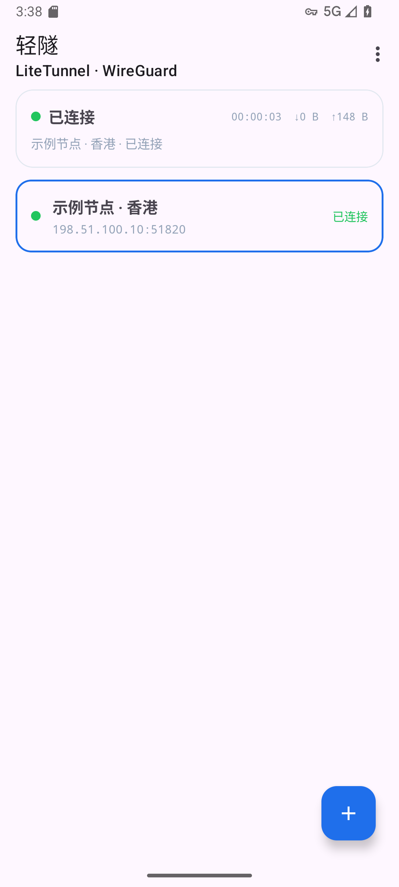
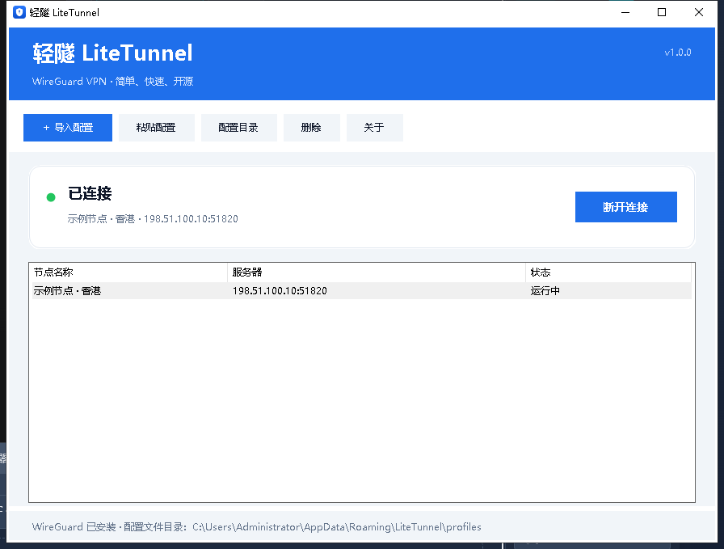

# 轻隧 LiteTunnel

一套**可自托管、开源**的 WireGuard VPN 方案：服务端一条命令安装，附带 Android 与 Windows 客户端。

> 适合：自建 VPS 访问公网、家庭/公司内网互联、给手机和电脑统一出口。
> 服务端使用标准 WireGuard 协议，**客户端也可以直接使用官方 WireGuard App** 导入配置。
>
> ⚠️ 如果你主要在中国大陆使用，请先阅读 [docs/china.md](docs/china.md)：WireGuard 的 UDP 流量可能被干扰，文档里给出了 TCP 抗封锁的替代思路。

<p align="center">
  
  
  
</p>

## 功能

- **服务端一键安装**：Debian / Ubuntu，自动安装依赖、开启转发、配置 NAT、生成密钥和客户端、生成二维码、注册 systemd 服务。
- **安卓客户端**：Kotlin + Material 3，支持扫码 / 粘贴 / 导入 `.conf`，多节点管理、连接状态、实时流量统计。
- **Windows 客户端**：C# WinForms，单文件 exe，导入 / 粘贴配置，一键连接 / 断开，自动检测官方 WireGuard for Windows。
- **标准协议**：没有自造加密协议，服务端就是标准 WireGuard，可以用官方客户端、路由器或其他兼容工具连接。
- **开源**：Apache-2.0，代码量小，便于学习和二次开发。

## 项目结构

```text
litetunnel/
├── server/
│   ├── install.sh              # 服务端一键安装
│   └── manage.sh               # 客户端管理（安装后为 /usr/local/bin/litetunnel）
├── clients/
│   ├── android/                # Android Studio / Gradle 工程
│   └── windows/                # .NET Framework 4.8 WinForms 工程与构建脚本
├── docs/
│   ├── china.md                # 中国大陆网络环境说明
│   └── screenshot-*.png
├── .github/workflows/build.yml # GitHub Actions：自动构建 APK 和 EXE
├── LICENSE / NOTICE
└── README.md
```

## 快速开始

### 1. 准备服务器

- 一台有公网 IPv4 的 VPS（Debian 11/12、Ubuntu 20.04/22.04/24.04，x86_64 或 arm64）
- 以 `root` 身份操作（或 `sudo`）
- 在云厂商安全组 / 防火墙中放行 **UDP 51820**（或你自定义的端口）
- 确认服务器没有被服务商限制 UDP 或 TUN 转发

### 2. 一行命令安装服务端

把下面命令里的 `YOUR_GITHUB_USER` 换成你的 GitHub 用户名（发布仓库后）：

```bash
curl -fsSL https://github.com/YOUR_GITHUB_USER/litetunnel/archive/refs/heads/main.tar.gz -o /tmp/litetunnel.tar.gz \
  && sudo tar xzf /tmp/litetunnel.tar.gz -C /opt \
  && sudo bash /opt/litetunnel-main/server/install.sh
```

或者先在本地把仓库传到服务器，再执行：

```bash
git clone --depth 1 https://github.com/YOUR_GITHUB_USER/litetunnel.git /opt/litetunnel
sudo bash /opt/litetunnel/server/install.sh
```

安装脚本会：

1. 安装 `wireguard-tools`、`qrencode`、`iptables`；
2. 开启 IPv4 转发并配置 NAT（让客户端可以访问公网）；
3. 生成服务端密钥、3 个客户端密钥和配置；
4. 生成每个客户端的 `.conf` 和 `.png` 二维码；
5. 启动并开机自启 `wg-quick@wg0`；
6. 安装管理命令 `/usr/local/bin/litetunnel`。

安装完成后会打印服务器公网 IP、端口、客户端目录：

```text
客户端配置目录 : /root/litetunnel/clients
已生成客户端：
  client1   IP: 10.66.66.2   配置: /root/litetunnel/clients/client1.conf  二维码: .../client1.png
  client2   IP: 10.66.66.3   ...
```

可以用 `scp` 把配置或二维码下载到本地：

```bash
scp root@你的服务器IP:/root/litetunnel/clients/client1.png .
scp root@你的服务器IP:/root/litetunnel/clients/client1.conf .
```

### 3. 添加更多客户端

```bash
sudo litetunnel add phone        # 添加名为 phone 的客户端
sudo litetunnel list             # 查看所有客户端、IP、握手时间、流量
sudo litetunnel qr phone         # 在终端里直接显示二维码
sudo litetunnel config phone     # 打印配置
sudo litetunnel del phone        # 删除并吊销
sudo litetunnel status           # 查看服务 / 端口状态
```

客户端名称只能使用字母、数字、下划线、短横线，最长 15 个字符。

### 4. 安装客户端

#### Android

- 从 GitHub Releases 下载 `LiteTunnel-Android-v1.0.0.apk`（或按下面“构建”一节自行编译）；
- 允许“安装未知来源应用”后安装；
- 打开 App，点右下角 **+**：
  - **扫码**：扫描服务端生成的 `client1.png`；
  - **粘贴**：从聊天软件/剪贴板粘贴完整配置；
  - **文件**：选择下载好的 `.conf`；
- 点节点 → 系统弹出 VPN 授权 → 允许 → 连接成功。

应用只保存配置在应用私有目录，**关闭了系统备份**，不会把私钥同步到云端。

#### Windows

1. 先安装官方开源的 [WireGuard for Windows](https://www.wireguard.com/install/)（客户端会调用它的隧道服务）；
2. 运行 `LiteTunnel.exe`，UAC 选择“是”（需要管理员权限来创建 VPN 服务）；
3. **导入配置** 或 **粘贴配置**；
4. 选中节点 → **连接**。

> 关闭 LiteTunnel 窗口不会自动断开 VPN；重新打开客户端即可看到连接状态并断开。
> LiteTunnel 只管理自己的配置目录中的隧道，不会影响你用官方 WireGuard 客户端创建的其它隧道。

### 5. 不想用自带客户端？

服务端生成的是标准 WireGuard 配置，可以直接导入：

- Android：[WireGuard 官方 App](https://play.google.com/store/apps/details?id=com.wireguard.android)
- Windows：[WireGuard for Windows](https://www.wireguard.com/install/)
- iOS / macOS：App Store 中的 WireGuard
- 路由器：OpenWrt 的 WireGuard 接口

扫码或导入 `.conf` 即可，无需使用本项目客户端。

## 服务端参数

安装时可通过环境变量覆盖默认值：

```bash
sudo WG_PORT=443 WG_CLIENTS=5 bash /opt/litetunnel-main/server/install.sh
```

| 变量 | 默认值 | 说明 |
| --- | --- | --- |
| `WG_PORT` | `51820` | WireGuard UDP 端口，可改为 443 等 |
| `WG_NET` | `10.66.66` | 虚拟网段前三段 |
| `WG_DNS` | `1.1.1.1, 8.8.8.8` | 下发给客户端的 DNS |
| `WG_MTU` | `1420` | 客户端 MTU |
| `WG_CLIENTS` | `3` | 初始客户端数量 |
| `WG_ENDPOINT` | 自动探测 | 服务器公网 IP；在 NAT 后面时必须手动指定 |
| `CLIENT_PREFIX` | `client` | 初始客户端名前缀 |
| `WG_IF` | `wg0` | 服务端网卡名 |

修改端口示例：

```bash
sudo WG_PORT=443 WG_ENDPOINT=1.2.3.4 bash /opt/litetunnel-main/server/install.sh
```

安装完成后状态文件在 `/etc/wireguard/litetunnel.env`，服务端配置在 `/etc/wireguard/wg0.conf`。

## 构建

### Android

环境要求：JDK 17+、Android SDK Platform 35、Android Build Tools。

```bash
cd clients/android
./gradlew assembleDebug      # 调试包
./gradlew assembleRelease    # 发布包
```

产物：

```text
clients/android/app/build/outputs/apk/debug/app-debug.apk
clients/android/app/build/outputs/apk/release/app-release.apk
```

> 默认 `release` 使用 Android 调试签名，方便直接安装测试。
> **正式发布前**请在 `app/build.gradle.kts` 中配置你自己的 keystore，否则不同机器构建的 APK 无法覆盖安装。

也可以用 Android Studio 直接打开 `clients/android` 目录构建。

### Windows

Windows 10/11 自带 .NET Framework 4.8，无需安装 Visual Studio 或 .NET SDK：

```powershell
powershell -ExecutionPolicy Bypass -File clients\windows\build.ps1
```

产物：`clients\windows\dist\LiteTunnel.exe`。

也可以在 Visual Studio 中打开 `clients/windows/LiteTunnel.csproj` 构建。

### 自动构建（GitHub Actions）

推送到 GitHub 后，`.github/workflows/build.yml` 会自动：

- 在 Ubuntu 上构建 Android debug/release APK；
- 在 Windows 上构建 `LiteTunnel.exe`；
- 把产物上传为 Actions Artifact。

发布版本时，从 Actions 下载 APK / EXE，创建 GitHub Release 并上传即可。

## 常见问题

### 手机显示已连接，但打不开网页

按顺序排查：

1. 服务器本机能否上网：`curl -I https://www.google.com`；
2. 服务端转发和 NAT：

   ```bash
   sysctl net.ipv4.ip_forward            # 应该是 1
   sudo iptables -t nat -L POSTROUTING -n -v
   sudo litetunnel status
   ```

3. 云厂商安全组是否放行 UDP 端口；
4. 客户端配置里的 `Endpoint` 是否是公网 IP；
5. 是否是 IPv6 泄漏：本项目客户端配置只接管 IPv4，若网络有 IPv6，可暂时关闭手机/电脑的 IPv6 再试。

### 完全连不上（没有握手）

```bash
sudo litetunnel status
sudo systemctl status wg-quick@wg0
sudo journalctl -u wg-quick@wg0 -n 50 --no-pager
sudo wg show
```

- `wg show` 里没有 `latest handshake`：UDP 没通，先查安全组、端口、服务器公网 IP；
- 有握手但没流量：查转发/NAT/DNS；
- 公共 Wi-Fi / 校园网/公司网络可能封 UDP，换手机热点测试。

### Windows 提示“未检测到 WireGuard”

先安装 [WireGuard for Windows](https://www.wireguard.com/install/)，安装后重启 LiteTunnel。

### Windows 无法启动 / 一闪而过

LiteTunnel 需要管理员权限。右键 → 以管理员身份运行，或确认 UAC 没有拦截。

### 在中国大陆能用吗？

WireGuard 使用 UDP，特征明显，在部分网络会被限速或阻断。可以：

- 把端口改成 443/UDP 试试；
- 换网络（移动/联通/电信差异较大）；
- 使用 TCP 类方案（Xray REALITY、Trojan 等），参见 [docs/china.md](docs/china.md)。

本项目自带客户端只支持 WireGuard；Xray 方案可直接使用开源的 v2rayNG / v2rayN 导入分享链接。

### 卸载服务端

```bash
sudo litetunnel uninstall
```

会停止并删除 WireGuard 配置、客户端配置和管理命令，但保留已安装的系统软件包。

### 如何修改端口 / 网段？

`install.sh` 一次性生成配置，修改端口最稳妥的方式是：

```bash
sudo litetunnel uninstall
sudo WG_PORT=443 WG_ENDPOINT=你的公网IP bash /opt/litetunnel-main/server/install.sh
```

然后重新导出客户端配置。

## 安全说明

- 服务端为每个客户端生成独立的 `PrivateKey` 和 `PresharedKey`，客户端之间互相隔离（`AllowedIPs` 为单个 `/32`）。
- 客户端 `.conf` 包含私钥，等同于账号密码，**不要发到群里、不要提交到 Git**。
- 服务端配置和客户端配置权限为 `600`，仅 root 可读。
- WireGuard 本身不记录访问日志；但云厂商、上游网络仍可能看到连接元数据。
- 建议：

  ```bash
  apt-get update && apt-get upgrade -y
  # 如使用 UFW
  ufw allow 51820/udp
  ```

- 本项目不包含任何流量日志、账号系统或遥测。

## 发布到 GitHub

1. 新建一个名为 `litetunnel` 的公开仓库；
2. 推送到 `main` 分支；
3. 把 README 中的 `YOUR_GITHUB_USER` 替换成你的用户名；
4. 在 Actions 中等待构建完成，下载 Artifact；
5. 创建 Release（例如 `v1.0.0`），上传 APK 和 EXE。

```bash
git init
git add .
git commit -m "feat: initial LiteTunnel"
git branch -M main
git remote add origin https://github.com/YOUR_GITHUB_USER/litetunnel.git
git push -u origin main
```

## 协议与致谢

- 本项目代码：[Apache-2.0](LICENSE)
- [WireGuard](https://www.wireguard.com/) 是 Jason A. Donenfeld 的注册商标；本项目与 WireGuard 官方无隶属关系。
- Android 客户端使用官方 [WireGuard Android tunnel library](https://github.com/WireGuard/wireguard-android)（Apache-2.0）。
- Windows 客户端调用官方 [WireGuard for Windows](https://www.wireguard.com/install/)（GPL-2.0），不捆绑其二进制。
- 第三方组件清单见 [NOTICE](NOTICE)。

## 免责声明

本项目仅供学习网络技术、访问自建服务器和合法的远程办公/内网互联使用。请遵守你所在国家/地区的法律法规以及云服务商的使用条款，不要用于任何违法用途。因使用本项目产生的任何后果由使用者自行承担。
