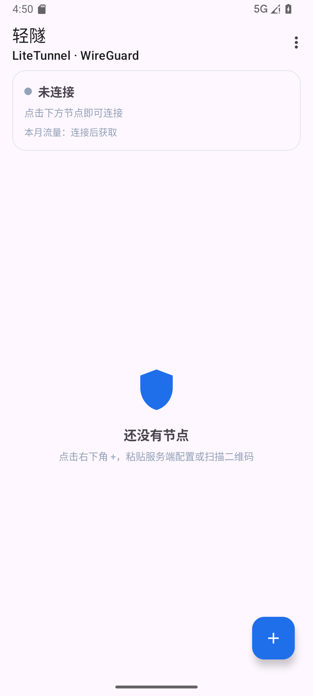

# 轻隧 LiteTunnel

一套**可自托管、开源**的 WireGuard VPN 方案：服务端一条命令安装，附带 Android 与 Windows 客户端。

> GitHub 仓库：<https://github.com/Brianown/VPN_Android_Windows>
>
> 适合：自建 VPS 访问公网、家庭/公司内网互联、给手机和电脑统一出口。
> 服务端使用标准 WireGuard 协议，**客户端也可以直接使用官方 WireGuard App** 导入配置。
>
> ⚠️ 如果你主要在中国大陆使用，请先阅读 [docs/china.md](docs/china.md)：WireGuard 的 UDP 流量可能被干扰，文档里给出了 TCP 抗封锁的替代思路。

<p align="center">
  
  
  
</p>

<p align="center"><sub>界面示意（示例节点，非真实服务器）</sub></p>

## 功能

- **服务端一键安装**：Debian / Ubuntu，自动安装依赖、开启转发、配置 NAT、生成密钥和客户端、生成二维码、注册 systemd 服务。
- **安卓客户端**：Kotlin + Material 3，支持扫码 / 粘贴 / 导入 `.conf`，多节点管理、连接状态、实时流量统计。
- **Windows 客户端**：C# WinForms，单文件 exe，导入 / 粘贴配置，一键连接 / 断开，自动检测官方 WireGuard for Windows。
- **服务端月度流量统计**：服务端按客户端累计本月接收/发送流量，每月最后一天结束（次月 1 日 00:00）清零；手机和 PC 从同一个 VPN 内网 API 读取，数字一致。
- **标准协议**：没有自造加密协议，服务端就是标准 WireGuard，可以用官方客户端、路由器或其他兼容工具连接。
- **开源**：Apache-2.0，代码量小，便于学习和二次开发。

## 加密与隐私（先读）

WireGuard 会加密客户端与服务器之间的**全部 IP 流量**，包括访问的域名、目的 IP、DNS 查询和网页内容，使用
Curve25519 + ChaCha20-Poly1305；每个客户端还额外配置了 `PresharedKey`（预共享密钥），相当于在公钥加密之上再加一层对称密钥。

但要明确边界：

| 谁能看到什么 | 能看到 |
| --- | --- |
| 本地网络 / 运营商 / 路径上的监听者 | 只看到你连接 VPN 服务器的 UDP 地址、端口、包大小和时间；看不到你访问的网站和内容 |
| VPN 服务器（以及有服务器 root 权限的人） | 能看到你访问的目的 IP、DNS 和未加密的 HTTP；HTTPS 内容仍由网站证书保护 |
| 目标网站 | 看到 VPN 服务器的 IP，而不是你的家庭/手机 IP |
| 服务器所在的云厂商 | 可能记录连接时间、流量大小等元数据 |

**“再加密”不能保证任何人绝对看不到**：如果还是同一个 VPN 服务器作为出口，它仍然能看到目的地；要隐藏
“谁访问了什么”，需要多跳网络或 Tor 这类匿名网络，而不是简单把同一个包再加密一次。任何声称“任何部门、
任何黑客都绝对无法监听”的软件都不可信。

- 想要**抗封锁**：使用 TCP/TLS 伪装（Xray REALITY 等），见 [docs/china.md](docs/china.md)；
- 想要**隐藏目的地**：使用 Tor 或多跳网络，详见 [docs/privacy.md](docs/privacy.md)；
- 日常使用：网站全站 HTTPS、开启加密 DNS、不要让 IPv6 绕过隧道、定期更新服务器。

## 项目结构

```text
VPN_Android_Windows/
├── server/
│   ├── install.sh              # 服务端一键安装
│   ├── manage.sh               # 客户端管理（安装后为 /usr/local/bin/litetunnel）
│   ├── traffic-stats.py        # 月度流量采集器（systemd timer 每分钟运行）
│   └── traffic-api.py          # 仅监听 VPN 内网的月度流量 API
├── clients/
│   ├── android/                # Android Studio / Gradle 工程
│   └── windows/                # .NET Framework 4.8 WinForms 工程与构建脚本
├── docs/
│   ├── china.md                # 中国大陆网络环境说明
│   ├── privacy.md              # 加密边界、隐私与多跳/匿名网络说明
│   └── screenshot-*.png
├── .github/workflows/build.yml # GitHub Actions：自动构建 APK 和 EXE
├── LICENSE / NOTICE
└── README.md
```

## 快速开始

### 1. 准备服务器

- 一台有公网 IPv4 的 VPS（Debian 11/12、Ubuntu 20.04/22.04/24.04，x86_64 或 arm64）
- 以 `root` 身份操作（或 `sudo`）
- 在云厂商安全组 / 防火墙中放行 **UDP 51820**（或你自定义的端口）
- 确认服务器没有被服务商限制 UDP 或 TUN 转发

### 2. 一行命令安装服务端

```bash
curl -fsSL https://github.com/Brianown/VPN_Android_Windows/archive/refs/heads/main.tar.gz -o /tmp/vpn.tar.gz \
  && sudo tar xzf /tmp/vpn.tar.gz -C /opt \
  && sudo bash /opt/VPN_Android_Windows-main/server/install.sh
```

如果 GitHub 访问慢，也可以先把仓库下载/上传到服务器，然后执行：

```bash
git clone --depth 1 https://github.com/Brianown/VPN_Android_Windows.git /opt/VPN_Android_Windows
sudo bash /opt/VPN_Android_Windows/server/install.sh
```

> 仓库名或默认分支不同的话，把上面的 `VPN_Android_Windows` / `main` 换成实际值。
> 如果服务器上没有 `git`，也可以直接上传 ZIP 解压后运行 `server/install.sh`。

安装脚本会：

1. 安装 `wireguard-tools`、`qrencode`、`iptables`；
2. 开启 IPv4 转发并配置 NAT（让客户端可以访问公网）；
3. 生成服务端密钥、3 个客户端密钥和配置；
4. 生成每个客户端的 `.conf` 和 `.png` 二维码；
5. 启动并开机自启 `wg-quick@wg0`；
6. 安装管理命令 `/usr/local/bin/litetunnel`；
7. 生成 `/root/litetunnel/clients/import-all.txt`，并在终端打印**所有客户端需要导入的完整设置**。

安装完成后会看到类似输出：

```text
============================
所有客户端需要导入的设置。
============================
服务器: 203.0.113.10:51820
说明: 从每个客户端的 [Interface] 开始复制到文件末尾，粘贴到客户端即可。
      以下内容包含客户端私钥，请通过安全渠道传输。

----- client1 -----
[Interface]
PrivateKey = ...
Address = 10.66.66.2/24
DNS = 1.1.1.1, 8.8.8.8
MTU = 1420

[Peer]
PublicKey = ...
PresharedKey = ...
Endpoint = 203.0.113.10:51820
AllowedIPs = 0.0.0.0/0
PersistentKeepalive = 25
...
```

如果不希望私钥出现在终端里，可以在安装时关闭打印：

```bash
sudo WG_PRINT_CONFIGS=0 bash server/install.sh
```

之后随时可以重新生成并打印：

```bash
sudo litetunnel export
```

也可以用 `scp` 下载单个配置或二维码：

```bash
scp root@你的服务器IP:/root/litetunnel/clients/client1.png .
scp root@你的服务器IP:/root/litetunnel/clients/client1.conf .
scp root@你的服务器IP:/root/litetunnel/clients/import-all.txt .
```

### 3. 添加更多客户端

```bash
sudo litetunnel add phone        # 添加名为 phone 的客户端
sudo litetunnel add-pubkey pc <客户端公钥>  # 已有客户端私钥，只把公钥加到服务器
sudo litetunnel export           # 生成并打印所有客户端导入内容（含私钥）
sudo litetunnel server-key       # 查看服务器公钥 / Endpoint
sudo litetunnel list             # 查看所有客户端、IP、握手时间、流量
sudo litetunnel qr phone         # 在终端里直接显示二维码
sudo litetunnel config phone     # 打印配置
sudo litetunnel del phone        # 删除并吊销
sudo litetunnel status           # 查看服务 / 端口状态
sudo litetunnel traffic          # 查看服务端月度流量 JSON
```

客户端名称只能使用字母、数字、下划线、短横线，最长 15 个字符。

### 4. 密钥管理（重要）

WireGuard 使用“公钥 + 私钥”：

- **服务器私钥**只保存在服务器 `/etc/wireguard/wg0.conf`，权限 600；
- **客户端私钥**只保存在客户端配置 `.conf` 里，服务器和客户端各有一份；
- 每对客户端还额外生成 `PresharedKey`，相当于再加一层对称密钥；
- **不要把私钥发到聊天、GitHub、群里**。需要给别人设备添加访问权限时，只交换公钥。

常用命令：

```bash
sudo litetunnel server-key        # 查看服务器公钥和 Endpoint
sudo litetunnel config phone      # 查看 phone 客户端的完整配置（含私钥，注意保密）
sudo litetunnel add laptop        # 新设备：生成新密钥和完整配置
sudo litetunnel add-pubkey pc <客户端公钥>
```

`add-pubkey` 适用于“客户端已经有自己的私钥”的场景：它把公钥加到服务器，并返回 Peer 模板（包含服务器公钥、
PresharedKey、Endpoint），不会生成或显示客户端私钥。

> 本项目不会在聊天或网页里替你生成并发送私钥。私钥一旦离开你的设备/服务器，就应该视为泄露，必须用
> `sudo litetunnel del 名称` 删除并用新名称重新添加。

### 5. 安装客户端

#### Android

- 从 GitHub Releases 下载 `LiteTunnel-Android-v1.1.0.apk`（或按下面“构建”一节自行编译）；
- 允许“安装未知来源应用”后安装；
- 打开 App，点右下角 **+**：
  - **扫码**：扫描服务端生成的 `client1.png`；
  - **粘贴**：从聊天软件/剪贴板粘贴完整配置；
  - **文件**：选择下载好的 `.conf`；
- 点节点 → 系统弹出 VPN 授权 → 允许 → 连接成功。

应用只保存配置在应用私有目录，**关闭了系统备份**，不会把私钥同步到云端。

#### Windows

1. 先安装官方开源的 [WireGuard for Windows](https://www.wireguard.com/install/)（客户端会调用它的隧道服务）；
2. 运行 `LiteTunnel.exe`，UAC 选择“是”（需要管理员权限来创建 VPN 服务）；
3. **导入配置** 或 **粘贴配置**；
4. 选中节点 → **连接**。

> 关闭 LiteTunnel 窗口不会自动断开 VPN；重新打开客户端即可看到连接状态并断开。
> LiteTunnel 只管理自己的配置目录中的隧道，不会影响你用官方 WireGuard 客户端创建的其它隧道。

### 6. 不想用自带客户端？

服务端生成的是标准 WireGuard 配置，可以直接导入：

- Android：[WireGuard 官方 App](https://play.google.com/store/apps/details?id=com.wireguard.android)
- Windows：[WireGuard for Windows](https://www.wireguard.com/install/)
- iOS / macOS：App Store 中的 WireGuard
- 路由器：OpenWrt 的 WireGuard 接口

扫码或导入 `.conf` 即可，无需使用本项目客户端。

## 月度流量统计

服务端安装时会同时部署：

- `litetunnel-traffic.timer`：每 60 秒读取一次 `wg show` 的累计计数器，按客户端累加到当前自然月；
- `litetunnel-api.service`：只监听 VPN 内网地址 `10.66.66.1:8080`，通过每个客户端配置里的随机 `StatsToken` 返回该客户端自己的统计；
- 状态文件：`/var/lib/litetunnel/traffic.json`（root 600 权限）。

**清零时间**：每月最后一天结束、次月 1 日 00:00（默认 `Asia/Shanghai`）清零重新累计。
第一次安装或第一次连接时以当前 `wg` 计数器为基线，不会把安装前的历史流量算进去。

客户端配置会自动包含：

```ini
# StatsURL = http://10.66.66.1:8080/api/traffic
# StatsToken = <该客户端专属随机 token>
```

连接后，Android / Windows 客户端会每 60 秒查询一次，并显示：

```text
本月流量：↓ 1.2 GB   ↑ 300.0 MB（2026-11）
```

> `↓` 是服务器发给客户端的数据（客户端下载），`↑` 是服务器收到的数据（客户端上传）。
> API 原始字段 `rx` 表示服务器接收（上传），`tx` 表示服务器发送（下载）。

- 同一份配置导入手机和电脑，两者显示同一客户端的同一份数据；
- 不同客户端（client1/client2）有独立 token，各自统计，互不混淆；
- 客户端未连接时显示“连接后获取”，不会在公网直接查询 API。

服务端排查命令：

```bash
sudo litetunnel traffic
systemctl status litetunnel-api.service litetunnel-traffic.timer
journalctl -u litetunnel-api.service -n 50 --no-pager
journalctl -u litetunnel-traffic.service -n 50 --no-pager
```

> 如果使用 UFW/firewalld 之外的防火墙，需要放行 **VPN 内网来源** 到 TCP `8080`；
> API 不应暴露到公网。
>
> 旧版本生成的客户端配置没有 `StatsURL/StatsToken`，重新执行 `sudo litetunnel add 名称`
> 生成新客户端，或重新安装即可。

## 服务端参数

安装时可通过环境变量覆盖默认值：

```bash
sudo WG_PORT=443 WG_CLIENTS=5 bash /opt/VPN_Android_Windows-main/server/install.sh
```

| 变量 | 默认值 | 说明 |
| --- | --- | --- |
| `WG_PORT` | `51820` | WireGuard UDP 端口，可改为 443 等 |
| `WG_NET` | `10.66.66` | 虚拟网段前三段 |
| `WG_DNS` | `1.1.1.1, 8.8.8.8` | 下发给客户端的 DNS |
| `WG_MTU` | `1420` | 客户端 MTU |
| `WG_CLIENTS` | `3` | 初始客户端数量 |
| `WG_ENDPOINT` | 自动探测 | 服务器公网 IP；在 NAT 后面时必须手动指定 |
| `CLIENT_PREFIX` | `client` | 初始客户端名前缀 |
| `WG_IF` | `wg0` | 服务端网卡名 |
| `WG_PRINT_CONFIGS` | `1` | 安装完成后打印所有客户端配置；`0` 关闭 |
| `STATS_PORT` | `8080` | 月度流量 API 端口（只监听 VPN 内网） |
| `STATS_TZ` | `Asia/Shanghai` | 月度流量清零时区 |

修改端口示例：

```bash
sudo WG_PORT=443 WG_ENDPOINT=1.2.3.4 bash /opt/VPN_Android_Windows-main/server/install.sh
```

安装完成后状态文件在 `/etc/wireguard/litetunnel.env`，服务端配置在 `/etc/wireguard/wg0.conf`。

## 构建

### Android

环境要求：JDK 17+、Android SDK Platform 35、Android Build Tools。

```bash
cd clients/android
./gradlew assembleDebug      # 调试包
./gradlew assembleRelease    # 发布包
```

产物：

```text
clients/android/app/build/outputs/apk/debug/app-debug.apk
clients/android/app/build/outputs/apk/release/app-release.apk
```

> 默认 `release` 使用 Android 调试签名，方便直接安装测试。
> **正式发布前**请在 `app/build.gradle.kts` 中配置你自己的 keystore，否则不同机器构建的 APK 无法覆盖安装。

也可以用 Android Studio 直接打开 `clients/android` 目录构建。

### Windows

Windows 10/11 自带 .NET Framework 4.8，无需安装 Visual Studio 或 .NET SDK：

```powershell
powershell -ExecutionPolicy Bypass -File clients\windows\build.ps1
```

产物：`clients\windows\dist\LiteTunnel.exe`。

也可以在 Visual Studio 中打开 `clients/windows/LiteTunnel.csproj` 构建。

### 自动构建（GitHub Actions）

推送到 GitHub 后，`.github/workflows/build.yml` 会自动：

- 在 Ubuntu 上构建 Android debug/release APK；
- 在 Windows 上构建 `LiteTunnel.exe`；
- 把产物上传为 Actions Artifact。

发布版本时，从 Actions 下载 APK / EXE，创建 GitHub Release 并上传即可。

## 常见问题

### 手机显示已连接，但打不开网页

按顺序排查：

1. 服务器本机能否上网：`curl -I https://www.google.com`；
2. 服务端转发和 NAT：

   ```bash
   sysctl net.ipv4.ip_forward            # 应该是 1
   sudo iptables -t nat -L POSTROUTING -n -v
   sudo litetunnel status
   ```

3. 云厂商安全组是否放行 UDP 端口；
4. 客户端配置里的 `Endpoint` 是否是公网 IP；
5. 是否是 IPv6 泄漏：本项目客户端配置只接管 IPv4，若网络有 IPv6，可暂时关闭手机/电脑的 IPv6 再试。

### 完全连不上（没有握手）

```bash
sudo litetunnel status
sudo systemctl status wg-quick@wg0
sudo journalctl -u wg-quick@wg0 -n 50 --no-pager
sudo wg show
```

- `wg show` 里没有 `latest handshake`：UDP 没通，先查安全组、端口、服务器公网 IP；
- 有握手但没流量：查转发/NAT/DNS；
- 公共 Wi-Fi / 校园网/公司网络可能封 UDP，换手机热点测试。

### Windows 提示“未检测到 WireGuard”

先安装 [WireGuard for Windows](https://www.wireguard.com/install/)，安装后重启 LiteTunnel。

### Windows 无法启动 / 一闪而过

LiteTunnel 需要管理员权限。右键 → 以管理员身份运行，或确认 UAC 没有拦截。

### 在中国大陆能用吗？

WireGuard 使用 UDP，特征明显，在部分网络会被限速或阻断。可以：

- 把端口改成 443/UDP 试试；
- 换网络（移动/联通/电信差异较大）；
- 使用 TCP 类方案（Xray REALITY、Trojan 等），参见 [docs/china.md](docs/china.md)。

本项目自带客户端只支持 WireGuard；Xray 方案可直接使用开源的 v2rayNG / v2rayN 导入分享链接。

### 客户端显示“本月流量：暂时无法获取”

按顺序检查：

```bash
sudo litetunnel traffic
systemctl status litetunnel-api.service litetunnel-traffic.timer
journalctl -u litetunnel-api.service -n 50 --no-pager
```

- 必须**先连接 VPN**，再查询 `http://10.66.66.1:8080`；公网访问不到是正常的；
- 服务器防火墙要允许 VPN 内网 `10.66.66.0/24` 访问 TCP `8080`；
- 如果 `traffic.json` 不存在，先手动触发一次采集：`sudo systemctl start litetunnel-traffic.service`；
- 旧版客户端配置没有 `StatsURL/StatsToken`，用 `sudo litetunnel add 新名称` 重新生成配置。

### 两个客户端的月度流量不一样

统计是按客户端配置（WireGuard 公钥 + `StatsToken`）区分的：

- 同一份 `.conf` 导入手机和电脑 → 显示同一份数据；
- 不同 `.conf`（client1 / client2）→ 各自统计，这是正常的。

### 流量什么时候清零？

默认在每月最后一天结束、次月 1 日 00:00（`Asia/Shanghai`）清零。
采集器每分钟运行一次，所以清零后最多约 1 分钟显示旧值。

### 卸载服务端

```bash
sudo litetunnel uninstall
```

会停止并删除 WireGuard 配置、客户端配置和管理命令，但保留已安装的系统软件包。

### 如何修改端口 / 网段？

`install.sh` 一次性生成配置，修改端口最稳妥的方式是：

```bash
sudo litetunnel uninstall
sudo WG_PORT=443 WG_ENDPOINT=你的公网IP bash /opt/VPN_Android_Windows-main/server/install.sh
```

然后重新导出客户端配置。

## 安全说明

- 服务端为每个客户端生成独立的 `PrivateKey` 和 `PresharedKey`，客户端之间互相隔离（`AllowedIPs` 为单个 `/32`）。
- 客户端 `.conf` 包含私钥，等同于账号密码，**不要发到群里、不要提交到 Git**。
- 服务端配置和客户端配置权限为 `600`，仅 root 可读。
- WireGuard 本身不记录访问日志；但云厂商、上游网络仍可能看到连接元数据。
- 建议：

  ```bash
  apt-get update && apt-get upgrade -y
  # 如使用 UFW
  ufw allow 51820/udp
  ```

- 本项目不包含任何流量日志、账号系统或遥测。
- 月度流量 `StatsToken` 只能读取该客户端自己的流量数字，不能操作 VPN；API 只监听 VPN 内网，仍然建议不要把它转发到公网。
- 加密能保护“内容”，但不能让 VPN 服务器看不到你的目的地；详见 [docs/privacy.md](docs/privacy.md) 和 [docs/china.md](docs/china.md)。

## 发布到 GitHub

本地仓库已经初始化并提交，只需推送到：

```text
https://github.com/Brianown/VPN_Android_Windows.git
```

```bash
# HTTPS（需要 GitHub 个人访问令牌）
git remote add origin https://github.com/Brianown/VPN_Android_Windows.git
# 或 SSH（需要把公钥加到 GitHub，或仓库的 Deploy key 并勾选 write access）
# git remote add origin git@github.com:Brianown/VPN_Android_Windows.git
git push -u origin main
```

推送后：

1. 在 Actions 中等待构建完成，下载 Artifact；
2. 创建 Release（例如 `v1.1.0`），上传 APK 和 EXE。

> 随附的 `litetunnel-v1.1.0.zip` 中包含预编译的 APK / EXE（位于 `release/`）。
> `release/` 已被 `.gitignore` 忽略，发布时建议把这两个文件上传到 GitHub Release，
> 而不是直接提交进 Git 仓库。

## 协议与致谢

- 本项目代码：[Apache-2.0](LICENSE)
- [WireGuard](https://www.wireguard.com/) 是 Jason A. Donenfeld 的注册商标；本项目与 WireGuard 官方无隶属关系。
- Android 客户端使用官方 [WireGuard Android tunnel library](https://github.com/WireGuard/wireguard-android)（Apache-2.0）。
- Windows 客户端调用官方 [WireGuard for Windows](https://www.wireguard.com/install/)（GPL-2.0），不捆绑其二进制。
- 第三方组件清单见 [NOTICE](NOTICE)。

## 免责声明

本项目仅供学习网络技术、访问自建服务器和合法的远程办公/内网互联使用。请遵守你所在国家/地区的法律法规以及云服务商的使用条款，不要用于任何违法用途。因使用本项目产生的任何后果由使用者自行承担。
